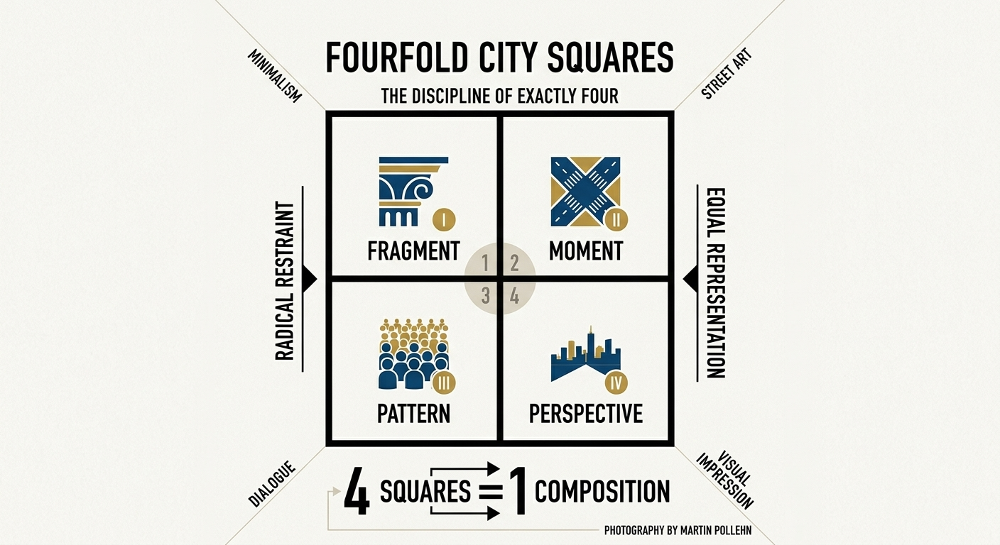

# fourfold-city-squares
city tours in four&sup2; pictures

a photographic art project exploring the tension between constraint and composition. each city is distilled into exactly four images — no more, no less — arranged as a single square grid: four squares forming one square.

the discipline lies in the limitation. where a conventional photo essay might sprawl across dozens of frames, fourfold city squares demands radical editorial restraint: four moments, four perspectives, four fragments of a place, chosen to speak as one. the square format — historically associated with the rolleiflex, the hasselblad, the early instagram — strips away the narrative of the wider panoramic view and forces each image into an equal, self-contained field. nothing dominates. no single photograph claims priority over another.

##city as a dialogue##
the result is less a documentary record of a city than a visual impression of it — a studied reduction, somewhere between street photography and minimalist visual art. the grid becomes a new composition in itself, the four images entering into dialogue across their shared borders.

**photography by Martin Pollehn**
